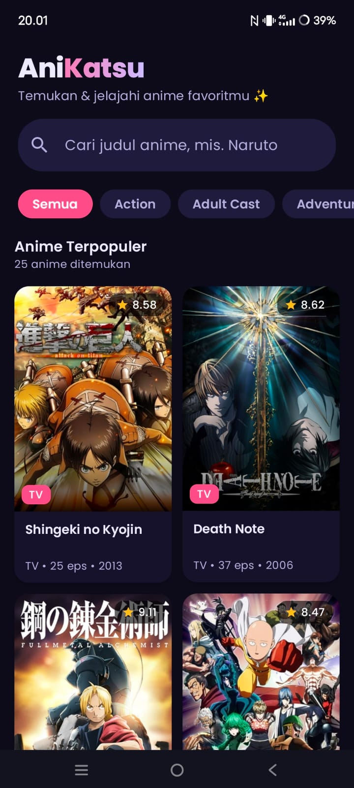
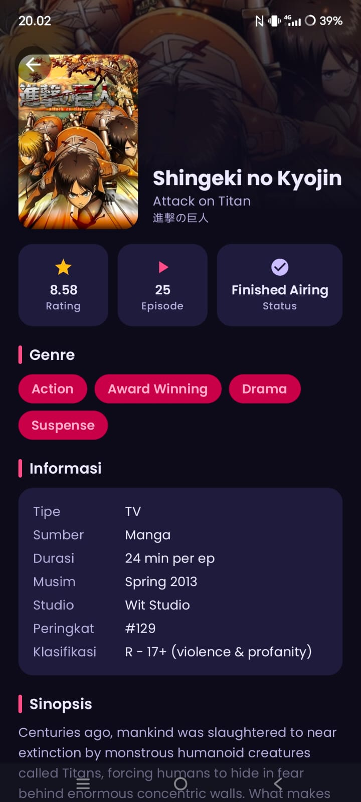

# AniKatsu - Aplikasi Katalog & Pencarian Anime

Aplikasi mobile berbasis **Android** yang dikembangkan menggunakan **Kotlin**, **Jetpack Compose**, **Material Design 3**, **Navigation Component**, dan **Arsitektur MVVM (Model-View-ViewModel)**. Aplikasi ini memungkinkan pengguna untuk mencari katalog anime, memfilter berdasarkan genre, serta melihat informasi detail anime secara dinamis dari **Tenrai REST API** (`https://api.tenrai.org/v1/`).

---

## 1. Nama Aplikasi

**AniKatsu** *(Anime Catalog & Discovery App)*

- **Package Name**: `com.pemmob.responsikotlinshiftg`
- **Platform**: Android (Min SDK 24, Target SDK 35)
- **Bahasa**: Kotlin
- **UI Framework**: Jetpack Compose + Material Design 3

---

## 2. Deskripsi Singkat Aplikasi

**AniKatsu** adalah aplikasi penjelajah anime modern yang memberikan pengalaman pengguna yang cepat, bersih, dan responsif. Fitur utama aplikasi meliputi:
- **Katalog Anime Populer**: Menampilkan daftar anime dalam bentuk *LazyVerticalGrid* 2 kolom responsif.
- **Pencarian Real-Time (Debounce)**: Fitur pencarian judul anime dengan debounce 500ms di `HomeViewModel` untuk efisiensi request ke server.
- **Filter Genre Dinamis**: Filter kategori anime (*Action*, *Adventure*, *Fantasy*, *Comedy*, dll.) menggunakan *Filter Chips* horizontal yang terhubung langsung ke API.
- **Rincian Anime Mendalam**: Halaman detail dengan banner sinematik blur gradien, poster mengambang, rating skor bintang, jumlah episode, status tayang, genre (*FlowRow*), informasi studio, musim rilis, serta sinopsis lengkap.
- **Desain Modern & Dark Theme**: Menggunakan tema gelap (*Dark Mode*) dengan aksen *Coral Primary*, *Teal*, *Sunset Gold*, dan tipografi kustom dari keluarga font **Poppins**.
- **Icon Aplikasi Kustom**: Menggunakan icon karakter anime unik pada seluruh densitas mipmap.

---

## 3. Screenshot & GIF Aplikasi

### 1. Home Screen (Grid & Pencarian)


*Tampilan katalog anime 2 kolom, search bar, dan filter chip genre.*

### 2. Detail Screen (Informasi & Sinopsis)


*Tampilan header sinematik, rating bintang, jumlah episode, status penayangan, genre, dan sinopsis lengkap.*


---

## 4. Penjelasan Struktur MVVM

Aplikasi ini menerapkan pola arsitektur **MVVM (Model-View-ViewModel)** dengan pemisahan peran yang jelas (*Separation of Concerns*):

```
┌────────────────────────────────────────────────────────┐
│                   UI / Composable                      │
│      (HomeScreen, DetailScreen, AnimeCard, dll.)       │
└──────────────────────────┬─────────────────────────────┘
                           │ Mengamati State & Kirim Event
                           ▼
┌────────────────────────────────────────────────────────┐
│                      ViewModel                         │
│           (HomeViewModel, DetailViewModel)             │
│        - Mengelola UI State (StateFlow)                │
│        - Menjalankan Coroutines (viewModelScope)       │
│        - Logika Debounce Pencarian (500ms)             │
└──────────────────────────┬─────────────────────────────┘
                           │ Memanggil fungsi suspend
                           ▼
┌────────────────────────────────────────────────────────┐
│                     Repository                         │
│                  (AnimeRepository)                     │
│        - Single Source of Truth bagi ViewModel         │
│        - Menjalankan operasi pada Dispatchers.IO       │
│        - Mengembalikan Result<T>                       │
└──────────────────────────┬─────────────────────────────┘
                           │ Request HTTP via Retrofit
                           ▼
┌────────────────────────────────────────────────────────┐
│                    Data & Remote                       │
│     - Model / Data Class (Anime, Genre, Response)      │
│     - TenraiApiService (Retrofit Interface)            │
│     - ApiClient (OkHttpClient + Base URL Tenrai)       │
└────────────────────────────────────────────────────────┘
```

### Komponen Arsitektur:

1. **Model (Data Layer)**:
   - Terletak di `data/model/Anime.kt`.
   - Menggunakan `data class` untuk memetakan respon JSON secara aman (*type-safe*).
   - Menggunakan anotasi `@SerializedName` dari Gson.
   - Menerapkan *Null Safety* dengan tipe nullable (`?`) dan fallback Elvis operator (`?:`) pada properti `imageUrl` dan `scoreText`.

2. **Repository Layer**:
   - Terletak di `data/repository/AnimeRepository.kt`.
   - Mengabstraksi panggilan data jaringan dari ViewModel.
   - Seluruh fungsi suspend dijalankan di latar belakang menggunakan `withContext(Dispatchers.IO)`.
   - Menggunakan `runCatching` untuk mengembalikan tipe `Result<List<Anime>>` dan `Result<Anime>` secara aman tanpa crash.

3. **ViewModel Layer**:
   - `HomeViewModel.kt`: Mengelola `HomeUiState` (daftar anime, genre, filter terpilih, status loading, dan error). Menggunakan `searchJob?.cancel()` dan `delay(500)` untuk pencarian *debounce*.
   - `DetailViewModel.kt`: Mengambil `animeId` dari Navigation Component via `SavedStateHandle` dan memuat rincian anime ke dalam `DetailUiState`.
   - Seluruh state dibungkus dalam `StateFlow` yang bersifat *read-only* bagi UI.

4. **View (UI Layer)**:
   - `HomeScreen.kt` & `DetailScreen.kt`: Dibangun secara deklaratif dengan Jetpack Compose.
   - Bersifat *stateless* dan bereaksi terhadap perubahan `uiState` via `collectAsStateWithLifecycle()`.
   - Dilengkapi penanganan status terisolasi di `StateViews.kt`: `LoadingView`, `ErrorView` (dengan tombol *retry*), dan `EmptyView`.
   - Navigasi antar-layar dikelola oleh `AppNavigation.kt` dengan maksimal 2 screen (*Home* dan *Detail*).

---

## 5. Penjelasan Penggunaan API

Aplikasi menggunakan layanan **Tenrai REST API** (REST API MyAnimeList yang cepat dan andal):

- **Base URL**: `https://api.tenrai.org/v1/`

### Endpoint yang Digunakan:

1. **Katalog & Pencarian Anime**:
   - `GET /anime?q={query}&genres={id}&order_by=popularity&sort=asc`
   - Digunakan di `HomeScreen` untuk menampilkan anime populer, memfilter berdasarkan genre terpilih, dan mencari anime berdasarkan teks yang diketikkan pengguna.

2. **Detail Anime Berdasarkan ID**:
   - `GET /anime/{id}`
   - Digunakan di `DetailScreen` untuk mengambil rincian lengkap anime (skor, status, episode, durasi, musim, studio, dan sinopsis).

3. **Daftar Kategori Genre**:
   - `GET /genres/anime`
   - Digunakan untuk memuat daftar kategori genre secara dinamis ke dalam deretan *Filter Chips*.

### Klien Jaringan (Retrofit & OkHttp):
- Dikonfigurasi dalam `ApiClient.kt` menggunakan pola *Singleton*.
- Dilengkapi `HttpLoggingInterceptor` (level `BODY`) untuk kemudahan monitoring trafik jaringan pada Logcat.
- Pengaturan timeout jaringan: `connectTimeout`, `readTimeout`, dan `writeTimeout` selama 30 detik.
- Menggunakan `ErrorMapper.kt` untuk menerjemahkan exception HTTP (404, 429, 500) dan galat koneksi internet (`IOException`) menjadi pesan ramah dalam Bahasa Indonesia.

---

## 6. Struktur File Proyek

```
app/src/main/
├── AndroidManifest.xml
├── java/com/pemmob/responsikotlinshiftg/
│   ├── MainActivity.kt
│   ├── data/
│   │   ├── model/
│   │   │   └── Anime.kt
│   │   ├── remote/
│   │   │   ├── ApiClient.kt
│   │   │   └── TenraiApiService.kt
│   │   └── repository/
│   │       └── AnimeRepository.kt
│   ├── ui/
│   │   ├── components/
│   │   │   ├── AnimeCard.kt
│   │   │   └── StateViews.kt
│   │   ├── detail/
│   │   │   ├── DetailScreen.kt
│   │   │   └── DetailViewModel.kt
│   │   ├── home/
│   │   │   ├── HomeScreen.kt
│   │   │   └── HomeViewModel.kt
│   │   ├── navigation/
│   │   │   └── AppNavigation.kt
│   │   └── theme/
│   │       ├── Color.kt
│   │       ├── Theme.kt
│   │       └── Type.kt
│   └── util/
│       └── ErrorMapper.kt
└── res/
    ├── font/
    ├── mipmap-*/
    └── values/
        └── strings.xml
```

---

## 7. Cara Menjalankan Proyek

1. **Buka Proyek**: Buka folder `ResponsiKotlinShiftG` di Android Studio.
2. **Sinkronisasi Gradle**: Tunggu proses *Gradle Sync* selesai.
3. **Kompilasi**:
   ```bash
   ./gradlew assembleDebug
   ```
4. **Jalankan Aplikasi**: Pilih emulator Android (API 24+) atau perangkat fisik, lalu klik tombol **Run** (`Shift + F10`).
